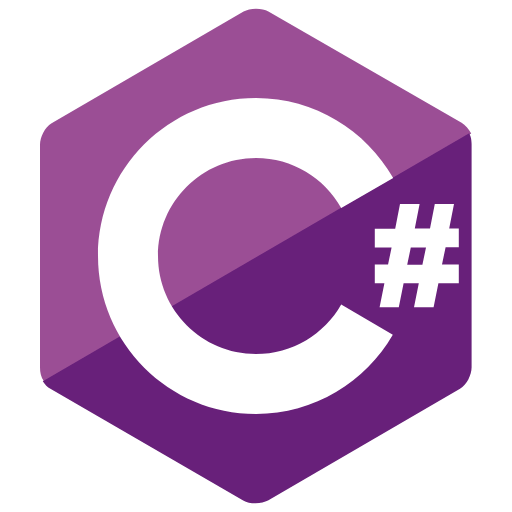
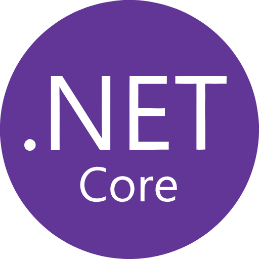

# 🌃 JavaPunk Coderunners 🌆
## Become the ultimate code runner!

JavaPunk Coderunners is a quiz-based Java learning platform where users can answer questions, complete modules, and earn points.

# Tech Stack:

☆ Language: C#

☆ Framework: ASP.NET Core (.NET 10)

☆ Database: SQLite

☆ ORM: Entity Framework Core

☆ Testing: xUnit and EF Core InMemory

  
